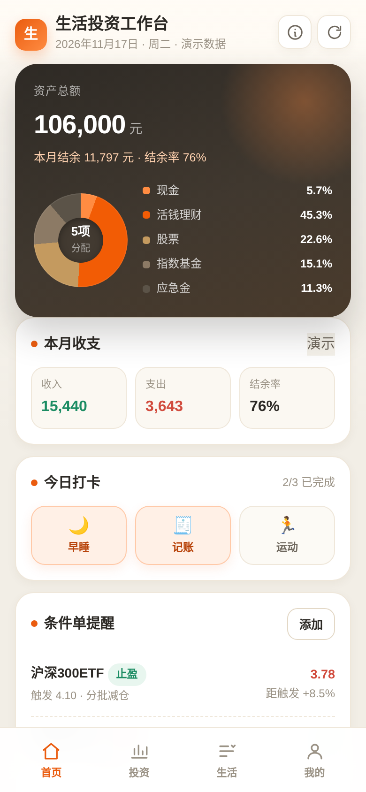
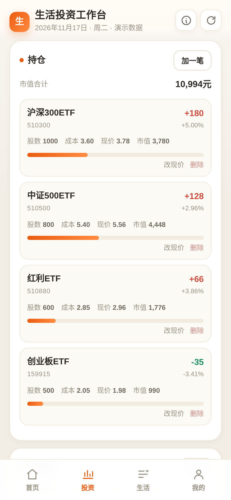
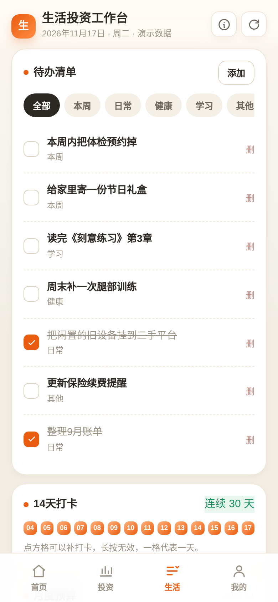

# 生活投资工作台

[](https://253631672.github.io/life-invest-workbench/) [](life-invest-workbench.html) [](#) [](LICENSE) [](#许可)

把资产分配、持仓、账本、待办和打卡放在同一屏。

单文件 HTML，双击就能用，不需要安装、注册或联网。数据只写在自己的浏览器里，不上传任何服务器。





## 能做什么

- **资产分配**：现金、活钱理财、股票、指数基金、应急金五项，环形图按占比铺开，结余率自动算
- **持仓**：股数、成本、现价、市值、浮盈、仓位六列，条件单显示到价距离
- **账本**：记一笔自动归到分类和月份，月度预算进度条跟着走
- **待办**：本周、日常、健康、学习、其他五段，完成状态可勾选
- **打卡**：早睡、记账、运动三项，14 天格子加连续天数
- **数据管理**：「我的」页导出 JSON、导入 JSON、重置演示数据

## 怎么用

0. 在线预览：https://253631672.github.io/life-invest-workbench/ ，不用下载，浏览器直接打开
1. 下载 `life-invest-workbench.html`
2. 电脑上双击，用浏览器打开
3. 手机上把文件传过去，用浏览器打开同一个文件
4. 首次打开是随机演示数据，看完在「我的」里重置或逐条删除，换成自己的

不联网也能用，断网打开功能完全正常。

## 数据在哪

存在浏览器 localStorage，键名 `life_invest_wb_v1`。换电脑、换浏览器、清缓存会丢，所以「我的」页放了导出和导入，建议每周导出一次。

## 已知限制

- 不联网取行情，「现价」需要点持仓卡片右下角手动改
- 条件单的到价距离按你填的现价估算，不是实时价格
- 只做个人记账和复盘，不接券商下单，也不构成投资建议

## 文件结构

```
life-invest-workbench.html   程序本体，44KB
screenshots/                 三张界面截图
LICENSE
```

如果这个工具帮你省了点时间，点个 Star 支持一下，也方便后面找到它。

## 许可

MIT。可自由使用、修改和商用，保留版权与许可声明即可，无需单独授权。
